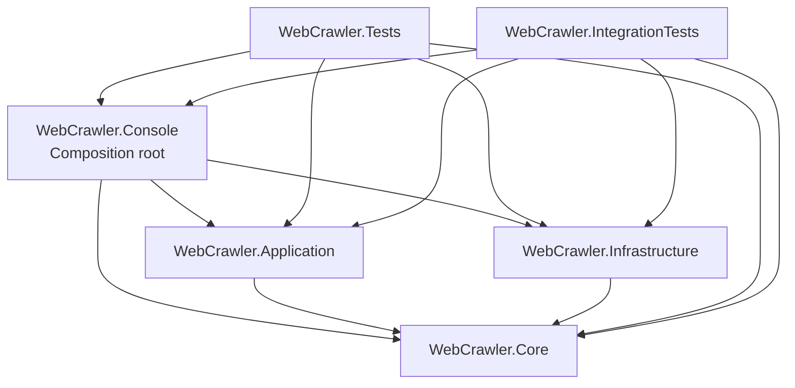
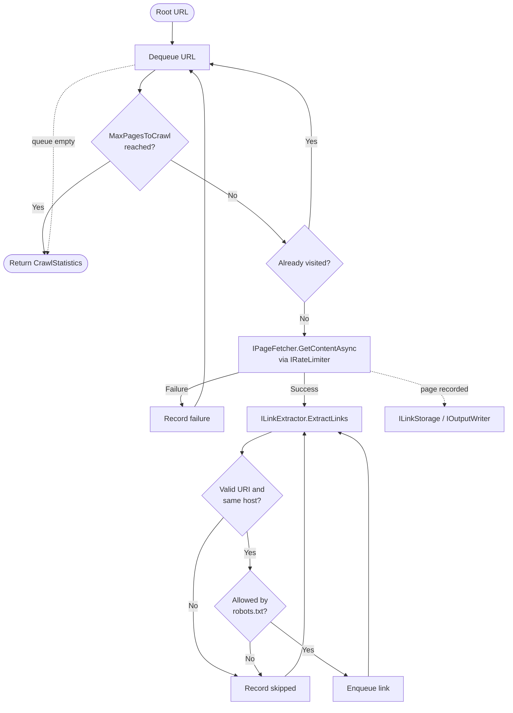
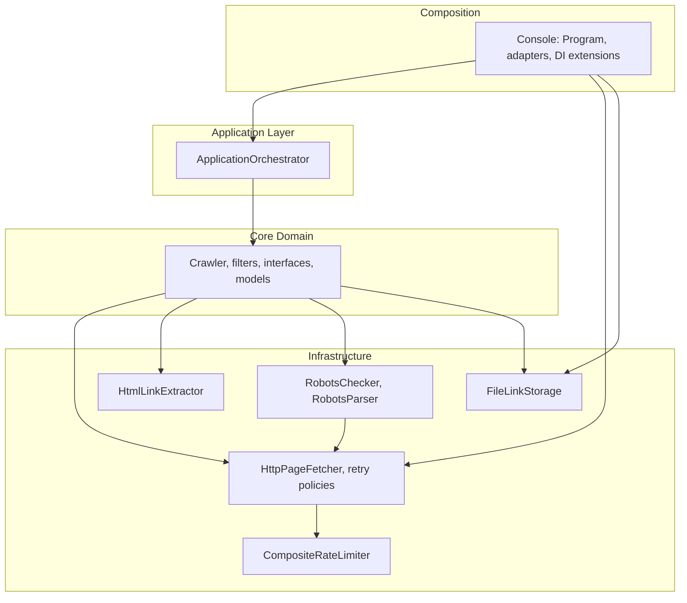

# WebCrawler Architecture

## Overview

WebCrawler is a .NET 10 console application that crawls pages starting from a configured URL. It fetches pages over HTTP, extracts links, applies URL filters and robots.txt rules, writes results to the console, and records visited links to file storage.

The solution follows a layered design. Dependencies point inward: the Console composition root depends on Infrastructure, Application, and Core, and Core depends on nothing else in the solution.

## Diagrams

### Project dependencies



### Crawl pipeline



### Layered architecture



## Projects

| Project |
|---|---|---|
| `WebCrawler.Core` | Domain | Interfaces, models, settings, exceptions, URL filters, and the `Crawler` orchestration service. |
| `WebCrawler.Application` | Application | `ApplicationOrchestrator`, which coordinates the run lifecycle. |
| `WebCrawler.Infrastructure` | Infrastructure | Concrete implementations: HTTP fetching and resilience policies, HTML link extraction, robots.txt handling, rate limiting, and file storage. |
| `WebCrawler.Console` | Composition root | Program entry point, console adapters, and DI registration extensions. |
| `WebCrawler.Tests` | Tests | NUnit unit tests for Core, Application, Infrastructure, and Console. |
| `WebCrawler.IntegrationTests` | Tests | NUnit end-to-end tests that run the real DI graph against a local Kestrel test server. |

## Core Components

### Crawl pipeline

`Crawler` (`WebCrawler.Core/Services/Crawler.cs`) implements `ICrawler`. It performs a breadth-first crawl. For each queued URL it:

1. Stops if `MaxPagesToCrawl` has been reached, and skips URLs already visited (normalized with `UrlHelper`).
2. Fetches the page with `IPageFetcher`. The fetcher applies `IRateLimiter` before each request.
3. Extracts links with `ILinkExtractor`. Each link is resolved against the current page and checked for a valid URI format and same host.
4. Checks `IRobotsChecker` for each link when `RespectRobotsTxt` is enabled.
5. Enqueues eligible links and records visited links through `ILinkStorage`. Output goes through `IOutputWriter`.
6. Tracks progress in `CrawlStatistics`.

The `IUrlFilterChain` and its filters (`UriFormatFilter`, `SameHostFilter`, `UniqueUrlFilter`, `RobotsTextFilter`) are available as reusable components, but `Crawler` currently applies the same checks inline rather than through the chain.

### Interfaces (Core)

- `IPageFetcher`, `ILinkExtractor`: fetching and parsing.
- `IRobotsChecker`, `IUrlFilter`, `IUrlFilterChain`: URL eligibility.
- `IRateLimiter`: request pacing.
- `ILinkStorage`, `IOutputWriter`: persistence and output.
- `IApplicationOrchestrator`, `IApplicationInteraction`, `IExceptionHandler`: application flow and error handling.

### Filters

- `UriFormatFilter`: rejects malformed URIs.
- `SameHostFilter`: restricts crawling to the starting host.
- `UniqueUrlFilter`: prevents revisiting a URL.
- `RobotsTextFilter` (Infrastructure): applies robots.txt rules.

### Exceptions

All custom exceptions derive from `WebCrawlerException`. Specific types include `ConfigurationException`, `PageFetchException`, `LinkExtractionException`, `RobotsException`, `StorageException`, and `UrlFilterException`.

## Infrastructure Components

- **HTTP** (`Http/`): `HttpPageFetcher` uses an `HttpClient` wrapped by `HttpPolicyFactory` and `HttpClientPolicies` for retry and circuit-breaker behavior.
- **Parsing** (`Parsing/`): `HtmlLinkExtractor` pulls `href` values from anchor tags.
- **Robots** (`Robots/`): `RobotsChecker` fetches and caches robots.txt per host. `RobotsParser` parses the rules. Robots URLs are built relative to the page URI so non-default ports are preserved.
- **Rate limiting** (`RateLimiting/`): `CompositeRateLimiter` combines the delay and concurrency limits.
- **Storage** (`Storage/`): `FileLinkStorage` writes visited links to a timestamped `visited_links_*.txt` file in the configured output directory. It is a singleton and must be disposed to flush output.

## Application Flow

1. `Program` (Console) loads `appsettings.json`, configures Serilog, and builds a `ServiceCollection` with the settings, `AddCrawlerInfrastructure`, and `AddCrawlerCore`.
2. `Program` resolves `IApplicationOrchestrator` and calls `RunAsync`.
3. `ApplicationOrchestrator` validates configuration through `ConfigurationValidator`, prompts for a URL through `IApplicationInteraction`, and validates the URL format.
4. `ApplicationOrchestrator` runs `Crawler` inside `IExceptionHandler`, displays results, and finalizes storage in a `finally` block.
5. Unhandled errors are reported through `IExceptionHandler`. Exit code is `1` on failure and `0` on success.

## Configuration

Settings are bound from `appsettings.json` into `WebCrawlerSettings` (Core). Key options include the default URL, `MaxPagesToCrawl`, delay, maximum concurrent requests, robots fetch timeout and cache expiration, connection timeout, storage flush interval, buffer size, and HTTP client policies.

`ConfigurationValidator` checks these values at startup and collects all errors before failing.

## Dependency Injection

- `CrawlerCoreServiceExtensions.AddCrawlerCore` registers core services and the `ICrawler` implementation. `Crawler` is constructed explicitly from `IOptions<WebCrawlerSettings>.Value`.
- `CrawlerInfrastructureServiceExtensions.AddCrawlerInfrastructure` registers the Infrastructure implementations and HTTP clients.

## Testing Strategy

- **Unit tests** (`WebCrawler.Tests`): isolate each class with mocks and fakes. They cover filters, parsers, storage, rate limiting, exception handling, and configuration validation.
- **Integration tests** (`WebCrawler.IntegrationTests`): start a local ASP.NET Core server on `127.0.0.1:0` with fixed pages and a `robots.txt`. They use the real DI registrations, so they run offline and deterministically.

## Build and Run

```powershell
dotnet build WebCrawler.slnx
dotnet test WebCrawler.slnx
dotnet run --project WebCrawler/WebCrawler.Console
```
