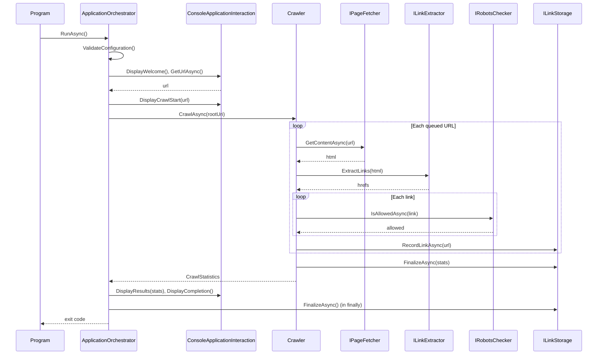

# WebCrawler Program Flow

This document describes how the application runs from startup to exit. For the component structure, see [ARCHITECTURE.md](ARCHITECTURE.md).

## 1. Startup (`WebCrawler.Console/Program.cs`)

1. **Build configuration.** `BuildConfiguration` loads `appsettings.json` from the current directory, then overlays environment variables.
2. **Configure logging.** `ConfigureLogging` creates a Serilog logger from the `Serilog` section (console and rolling file sinks under `./logs`).
3. **Build the service provider.** `ConfigureServices`:
   - Adds logging through Serilog.
   - Binds `WebCrawlerSettings` and `HttpClientPolicies` from configuration.
   - Calls `AddCrawlerInfrastructure` to register storage, rate limiting, HTTP fetching, link extraction, and robots.txt checking.
   - Calls `AddCrawlerCore` to register output, exception handling, the application orchestrator, the URL filter chain, and `ICrawler`.
4. **Run.** `RunApplicationAsync` resolves `IApplicationOrchestrator` and calls `RunAsync`.
5. **Exit.** `Log.CloseAndFlush()` runs in `finally`. The process returns `0` on success or `1` on failure. An exception that escapes startup is logged as fatal and returns `1`.

## 2. Orchestration (`ApplicationOrchestrator.RunAsync`)

1. **Validate configuration.** `ConfigurationValidator.Validate` checks the settings. A `ConfigurationException` displays an error and returns `1`.
2. **Show welcome.** `IApplicationInteraction.DisplayWelcome` prints the banner.
3. **Read the URL.** `GetUrlAsync` prompts the user. An empty entry uses `DefaultUrl` from settings.
4. **Validate the URL.** If `Uri.TryCreate` fails, the application shows an error and returns `1`.
5. **Start the crawl.** `DisplayCrawlStart` prints the start message. `_exceptionHandler.ExecuteAsync` wraps `ICrawler.CrawlAsync(rootUri)`.
6. **Show results.** `DisplayResults` prints the statistics report, the visited-links file path, and the latest log file path.
7. **Complete.** `DisplayCompletion` logs success and the method returns `0`.

Error handling:

- `ConfigurationException` displays a configuration error and returns `1`.
- `WebCrawlerException` and other exceptions are passed to `IExceptionHandler.Handle` and return `1`.
- The `finally` block always calls `ILinkStorage.FinalizeAsync()`. Finalization errors are logged and do not change the return value.

## 3. Crawling (`Crawler.CrawlAsync`)

The crawl is a breadth-first search using a `ConcurrentQueue<Uri>`.

1. Create `CrawlStatistics` with a start time, then enqueue the root URL.
2. Loop while the queue has items:
   1. **Check the page limit.** If `MaxPagesToCrawl` is set and the visited count has reached it, stop the loop.
   2. **Check for duplicates.** `UrlHelper.Normalize` produces a key for `_visited`. If the key already exists, increment `AlreadyVisited` and `LinksSkipped` and continue.
   3. **Fetch the page.** Increment `PagesProcessed`, then call `IPageFetcher.GetContentAsync`. The fetcher applies `IRateLimiter` and the HTTP resilience policies. On success, increment `PagesSuccessful` and add the body length to `TotalBytesDownloaded`.
   4. **Process each link.** `ILinkExtractor.ExtractLinks` returns the `href` values. For each link:
	  - Resolve it against the current page. Invalid URIs increment `InvalidFormat` and `LinksSkipped`.
	  - Skip links to other hosts (`UrlHelper.IsSameHost` against the root). Increment `DifferentHost` and `LinksSkipped`.
	  - If `RespectRobotsTxt` is enabled, check `IRobotsChecker.IsAllowedAsync`. Disallowed links increment `DisallowedByRobotsTxt` and `LinksSkipped`.
	  - Otherwise, add the link to `discoveredLinks`, increment `LinksDiscovered` and `LinksQueued`, and enqueue it.
   5. **Write output.** `IOutputWriter.Write` prints the page and its discovered links.
   6. **Record the page.** `ILinkStorage.RecordLinkAsync` writes the page URL to the visited-links file.
   7. **Handle errors.** `HttpRequestException` increments `PagesFailed` and `HttpErrors`. `OperationCanceledException` increments `PagesFailed` and `TimeoutErrors`. Other exceptions increment `PagesFailed` and `OtherErrors`. The loop continues with the next URL.
3. **Clean up in `finally`.** Any queued URLs are discarded and `_visited` is cleared.
4. **Finalize storage.** `ILinkStorage.FinalizeAsync(stats)` appends the statistics and flushes the file.
5. **Finish.** Set `EndTime` and return the statistics.

## 4. Storage and Output

- **`FileLinkStorage`** creates the configured output directory and writes `visited_links_<timestamp>.txt` in it. Writes are buffered and flushed every `StorageFlushIntervalLinks` links. The file is a singleton and must be disposed or finalized to flush the final content.
- **`ConsoleOutputWriter`** prints each page with its discovered links.

## 5. Robots.txt and Rate Limiting

- **`RobotsChecker`** fetches `/robots.txt` for each host through `IPageFetcher`, parses it with `RobotsParser`, and caches the rules per host for `RobotsCacheExpirationMinutes`. The robots URL is built from the page URI, which keeps any non-default port. If the fetch fails, links are allowed.
- **`CompositeRateLimiter`** enforces `DelayBetweenRequestsMs` between requests and limits concurrent requests to `MaxConcurrentRequests`.

## 6. Configuration Reference

| Setting | Used by | Effect |
|---|---|---|
| `DefaultUrl` | Orchestrator | URL used when the user enters nothing |
| `MaxPagesToCrawl` | Crawler | Stops the crawl after this many pages |
| `RespectRobotsTxt` | Crawler | Enables robots.txt checks on links |
| `DelayBetweenRequestsMs` | Rate limiter | Minimum delay between requests |
| `MaxConcurrentRequests` | Rate limiter | Concurrency limit |
| `RobotsCacheExpirationMinutes` | RobotsChecker | How long robots rules are cached |
| `RobotsFetchTimeoutSeconds` | RobotsChecker | Timeout for fetching robots.txt |
| `VisitedPagesOutputFilePath` | FileLinkStorage | Output directory for visited links |
| `StorageFlushIntervalLinks` | FileLinkStorage | Links written between flushes |
| `StorageWriterBufferSize` | FileLinkStorage | Writer buffer size |
| `HttpClientPolicies:*` | HTTP policies | Retry and circuit-breaker behavior |

## 7. Sequence Diagram

